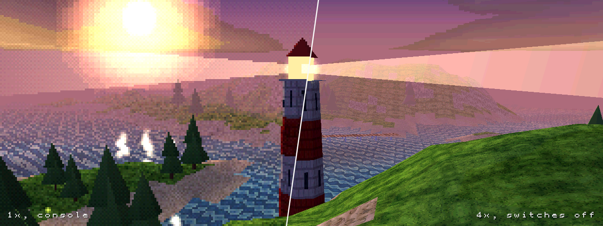

<p align="center">
  
</p>

<p align="center">
  <a href="https://github.com/jardarton/jitterbug/actions/workflows/ci.yml"></a>
  <a href="LICENSE"></a>
</p>

<p align="center">
  
</p>

<p align="center">
  <strong><a href="https://jardarton.github.io/jitterbug/">Try the live WebAssembly demo</a></strong> — fly over a sunset archipelago in your browser and toggle every PlayStation GPU artefact live.
</p>

**jitterbug** is a standalone C99/C11 PlayStation 1 (PS1 / PSX) software renderer for new PS1-style games, homebrew, and native ports or clean-room reimplementations. It is a renderer, not an engine: it renders headlessly to an RGBA8 frame buffer with no GPU or window required, so you bring your own game loop, window, input and audio — or drop it straight into SDL3, raylib, a browser canvas or automated visual tests.

## Why jitterbug

- **The console's own rules, not a shader imitation.** Rather than faking the look in floating-point shaders, jitterbug implements the GPU's integer rules: fill convention, 12-bit attribute gradients, 15-bit colour with 4x4 dithering, 4- and 8-bit palette textures, the four semi-transparency blend modes, mask bits, the CLUT cache and back-to-front depth sorting.
- **Classic artefacts on runtime switches.** Toggle internal resolution (1x–8x), sub-pixel vertices, perspective-correct texturing, 4x4 dithering, the CLUT cache, 16:9 widescreen and fixed-point GTE vs float geometry on the fly without recreating the context (15-bit colour, shared VRAM and depth sorting are part of the renderer in 0.1; [docs/api.md](docs/api.md)).
- **The real VRAM.** Textures, palettes and display buffers share one 1024x512 16-bit VRAM, so palette animation, render-to-texture and VRAM-to-VRAM copies behave as on the console ([docs/design.md](docs/design.md)).
- **Same pixels everywhere.** An integer-only console path paired with deterministic IEEE 754 maths (`-ffp-contract=off`) produces identical frame hashes across GCC and Clang, x86-64, aarch64 and wasm32, and from 1 to 16 rasterising threads ([docs/determinism.md](docs/determinism.md)).
- **One C99 header, no dependencies.** Strict C99 and C++11 public header ([include/jitterbug.h](include/jitterbug.h)), C11 core, no third-party runtime dependencies, no global state, and WebAssembly built in.

## Two API levels

- **High-level 3D/2D API (for new PS1-style games):** double-buffered frames, automatic VRAM placement, camera, lights, fog, clipping, `.jbm` meshes, `.jbt` textures, sprites, an original 8x8 bitmap font, and live switches for 1x–8x, widescreen, sub-pixel vertices and perspective-correct texturing.
- **Console-level API (for ports, static recompilations, reimplementations and homebrew):** direct GP0/GP1 command words, GPUREAD/GPUSTAT, 1024x512 16-bit VRAM transfers, ordering tables and fixed-point GTE (COP2) operations.

At 1x, jitterbug reproduces the real-console results published by [ps1-tests](https://github.com/JaCzekanski/ps1-tests) for 13 named GPU programs (11 VRAM dumps compared pixel for pixel on the 15 colour bits they carry, excluding 64 uninitialised-colour pixels in `lines`, plus 2 console logs) and 1150 GTE cases; our own hardware probe ([docs/probe.md](docs/probe.md)) has not yet been run on a console, and scaled output (2x–8x) is faithful to the console's rules rather than exact ([docs/conformance.md](docs/conformance.md)).

## A taste of the API

```c
#include <jitterbug.h>

int main(void)
{
    jb_context *jb = jb_create(NULL, NULL);
    if (!jb) return 1;

    jb_set_dither(jb, 1);
    jb_begin_frame(jb, JB_RGB(16, 24, 48));

    jb_poly tri = {
        .vertices = 3, .gouraud = 1,
        .v = {
            {.x = 160, .y = 32,  .color = JB_RGB(255, 96, 64)},
            {.x = 264, .y = 200, .color = JB_RGB(64, 224, 128)},
            {.x = 56,  .y = 200, .color = JB_RGB(64, 128, 255)},
        },
    };
    jb_draw_poly(jb, &tri);
    jb_draw_text(jb, 16, 16, JB_RGB(255, 240, 200), "HELLO JITTERBUG");
    jb_end_frame(jb);

    int w = 0, h = 0;
    const uint8_t *rgba = jb_frame(jb, &w, &h); /* upload to SDL, raylib or a canvas */
    (void)rgba;

    jb_destroy(jb);
    return 0;
}
```

For a 3D lit scene see [first-light](examples/first-light/README.md) (and [the archipelago demo](examples/demo/README.md), which runs [live on the web](https://jardarton.github.io/jitterbug/)); for raw GP0/GP1/GTE packets and the rest of the library see the [API tour](docs/api.md) and [include/jitterbug.h](include/jitterbug.h).

## Quick start

Add jitterbug to a CMake project with `FetchContent`:

```cmake
include(FetchContent)
FetchContent_Declare(jitterbug
  GIT_REPOSITORY https://github.com/jardarton/jitterbug.git
  GIT_TAG v0.1.1
)
FetchContent_MakeAvailable(jitterbug)

target_link_libraries(my_game PRIVATE jitterbug::jitterbug)
```

When built as a subproject, tests, tools, examples and install rules default to `OFF`, so only `jitterbug::jitterbug` is built. For `find_package(jitterbug 0.1)`, `add_subdirectory`, `pkg-config`, Nix and Emscripten (WebAssembly), see [docs/getting-started.md](docs/getting-started.md).

## Limitations

What jitterbug does not do, by design or not yet (planned work is tracked in [todo.md](todo.md)):

- **A renderer, not an engine.** No windowing, input, audio, physics or scene graph; it produces an RGBA8 frame buffer for your own loop.
- **No depth buffer.** Ordering is by back-to-front depth sorting (an ordering table), just as on the console, so intersecting polygons can sort imperfectly.
- **15-bit drawing colour and shared VRAM.** Primitives draw in 15-bit colour (dithered at 1x) into one 1024x512 16-bit VRAM shared by display buffers, palettes and textures (up to 256x256 per page); true-colour drawing is not in 0.1.
- **Software backend only in 0.1.** Rendering runs on the CPU at 1x–8x (with worker threads on native builds); a Vulkan backend (up to 16x) is planned after 0.1.
- **Linux and WebAssembly only so far.** Tested on Linux (x86-64, plus arm64 — cross-compiled on x86-64 and run under QEMU, and run natively in an Apple silicon NixOS virtual machine, `aarch64-linux`) and single-threaded WebAssembly (Emscripten); macOS and Windows are not yet built or tested.
- **Not a console emulator.** Does not emulate a PlayStation CPU, BIOS, CD-ROM, DMA or GPU timing, and does not run existing PlayStation software — it is a rendering backend you link into your own C/C++ game or native port.

## Status

**0.1.1** ships the software backend (1x–8x), both API levels, `.jbt`/`.jbm` asset loaders, the `jb-tex`, `jb-mesh` and `jb-bench` tools, and the `first-light` and `demo` examples, with no ABI stability promise before 1.0. See [CHANGELOG.md](CHANGELOG.md) for release details and [todo.md](todo.md) for the post-0.1 roadmap.

## Documentation

- [FAQ](FAQ.md) — short answers to common questions
- [Getting started](docs/getting-started.md) — installing, linking and drawing a first frame
- [API tour](docs/api.md) — guided tour by task; [include/jitterbug.h](include/jitterbug.h) is the full reference
- [Design](docs/design.md) — architecture, VRAM, threading and scope
- [Formats](docs/formats.md) & [Tools](docs/tools.md) — `.jbt`/`.jbm` formats, `jb-tex`, `jb-mesh` and `jb-bench`
- [Conformance](docs/conformance.md) & [Hardware probe](docs/probe.md) — console evidence, fitted rules, open questions and the MIPS probe
- [Determinism](docs/determinism.md) & [Performance](docs/performance.md) — cross-platform verification and benchmark numbers
- [Examples](examples/demo/README.md) — the archipelago demo (plus [first-light](examples/first-light/README.md))
- [Testing](docs/testing.md), [Contributing](CONTRIBUTING.md) & [Todo](todo.md) — test suite, philosophy, rules and post-0.1 roadmap
- [Changelog](CHANGELOG.md) & [Security](SECURITY.md) — release history and vulnerability reporting

## Licence

Zlib licence; see [LICENSE](LICENSE). Vendored dependencies under `third_party/` keep their own licences (see `third_party/*/README.md`). "PlayStation" is a trademark of Sony Interactive Entertainment; this project is not affiliated with Sony.
